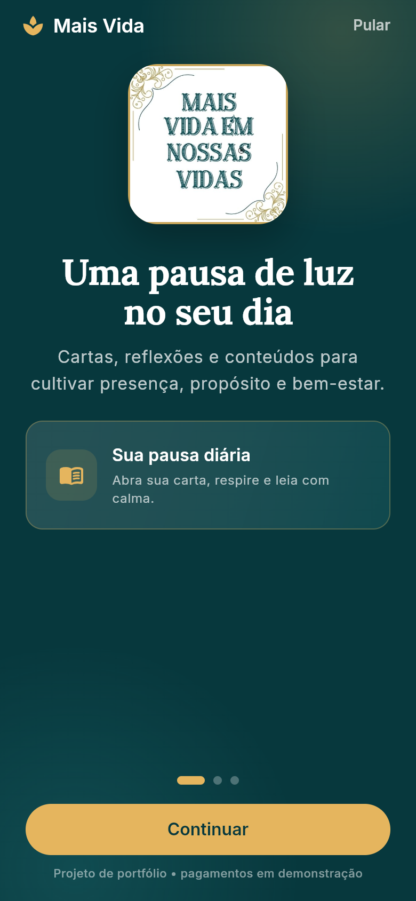
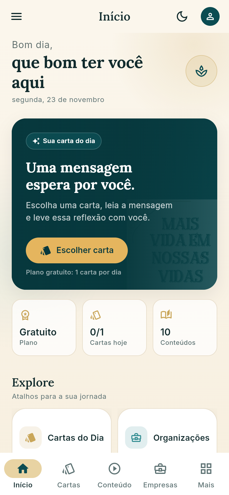
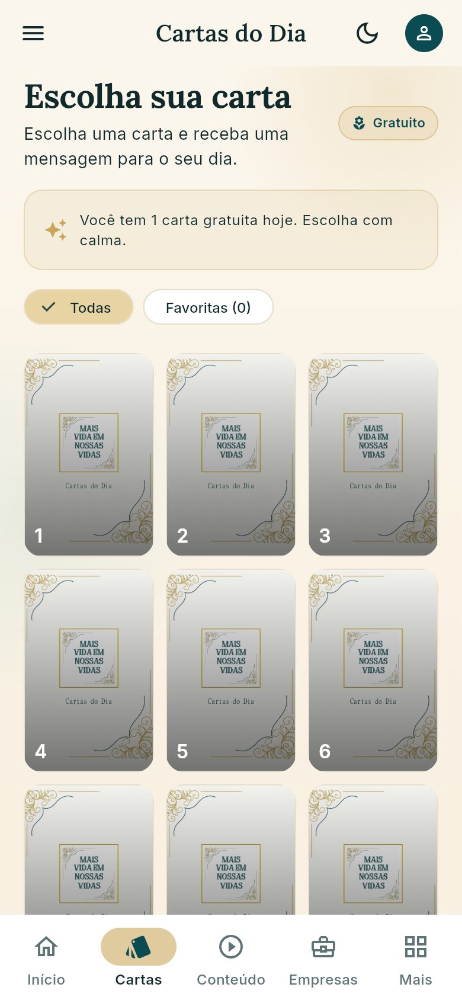
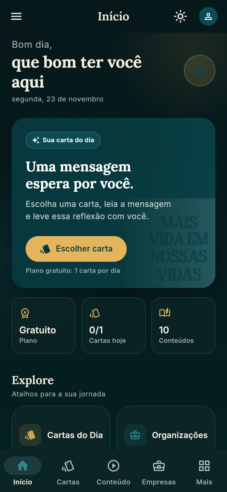

# Mais Vida em Nossas Vidas

Aplicativo mobile de espiritualidade e bem-estar, construído em Flutter, com cartas diárias ilustradas, temas de reflexão e uma experiência premium **em modo demonstração**.

> Projeto de portfólio. Não é publicado em loja e não processa pagamentos reais. Toda a experiência funciona offline.

## ✨ Destaques

- **Onboarding editorial** com identidade em petróleo e dourado e suporte a tema claro/escuro.
- **Cartas do Dia e Organizações**: 50 cartas em cada categoria, leitura em tela cheia com zoom, favoritos e compartilhamento.
- **Regras free/premium**: 1 carta gratuita por dia; assinatura libera cartas ilimitadas.
- **Premium demonstrativo**: PIX com BR Code válido (CRC16) e cartão com validação Luhn — sem cobrança e sem enviar dados.
- **Conteúdo** com 10 temas de reflexão do “Conheça Mais”.
- **Conta opcional** com OTP simulado para demonstrar restauração de acesso em outro aparelho.
- **Patrocinadores fictícios** e textos institucionais de demonstração.
- **Design system próprio**: cores, tipografia (Lora + Inter), componentes, skeletons, animações e acessibilidade.

## 📸 Telas

| Onboarding | Início | Cartas do Dia |
| --- | --- | --- |
|  |  |  |

| Início (tema escuro) |
| --- |
|  |

## 🧱 Stack

| Camada | Tecnologia |
|---|---|
| App | Flutter 3.50, Dart 3.14 |
| UI | `material_ui`, design system próprio, `flutter_animate` |
| Estado | `flutter_riverpod` |
| Compartilhamento | `share_plus`, `qr_flutter` |
| Persistência | `shared_preferences`, `flutter_secure_storage`, `sqflite` |
| Serviços | `path_provider`, `device_info_plus` |
| Backend | Node.js ESM, Express, Mongoose, Zod, JWT, Jest/Supertest |
| Qualidade | `flutter analyze`, testes unitários e suíte de backend |

## 🚀 Rodando o app

Pré-requisitos: Flutter stable (3.50+), Android SDK e um emulador/dispositivo.

```bash
flutter pub get
flutter run
```

No Windows, habilite o **Modo de Desenvolvedor** (necessário para symlinks de plugins):

```powershell
start ms-settings:developers
```

Build de demonstração:

```bash
flutter build apk --debug
# ou
flutter build apk --release
```

> As cartas e os ícones são embarcados no APK para funcionar 100% offline.

## 💳 Modo demonstração

O app abre com um selo explícito de demonstração. Nenhuma cobrança é realizada e nenhum dado sai do aparelho.

- PIX: gera um BR Code estruturalmente válido (CRC16) e ativa a assinatura localmente ao simular o pagamento.
- Cartão: formulário com máscara, Luhn e cartão de teste (`4242 4242 4242 4242`).
- Login: OTP fixo exibido na tela (`123456`) para demonstrar o fluxo de restauração.
- Para desativar o modo demo em uma build: `flutter run --dart-define=DEMO_MODE=false` (a integração real depende do backend).

## 🧪 Testes

```bash
flutter analyze
flutter test
cd backend && npm test
```

Cobertura atual:

- **36 testes no app**: `AssetResolver`, `BrCodeGenerator`, favoritos, temas, parceiros e verificações de privacidade.
- **65 testes no backend**: PIX, ativação idempotente, validação, expiração, cancelamento, webhook e rate limit.

## 📁 Estrutura

```
lib/
├── core/               # assets, pagamentos demo, configuração
├── design/             # tokens, tema e componentes visuais
├── features/           # conteúdo, favoritos, parceiros, pagamentos, settings
├── pages/              # onboarding, shell, dashboard, cartas, premium
├── services/           # assinatura, device, storage, logs
├── data/               # mensagens e catálogo local
└── main.dart
backend/                # API Node.js + MongoDB (opcional)
docs/                   # arquitetura, design, testes e legado
assets/                 # cartas, fontes e ícones
```

## 🧭 Arquitetura

- **Apresentação**: widgets + tema + componentes reutilizáveis.
- **Estado**: Riverpod para tema; estado local de tela com `setState` onde é simples e explícito.
- **Domínio**: repositórios e serviços testáveis (`AssetResolver`, `FavoritesRepository`, `TemasRepository`, `PartnersRepository`, `SubscriptionService`).
- **Dados**: preferências locais, armazenamento seguro e SQLite preparado para histórico.
- **Backend**: API versionada, validação Zod, entitlement por pagamento, testes com Mongo em memória.

Detalhes em [`docs/ARCHITECTURE.md`](docs/ARCHITECTURE.md) e [`docs/DESIGN_SYSTEM.md`](docs/DESIGN_SYSTEM.md).

## 📌 Limitações conhecidas

- Publicação em loja, assinatura real e envio de e-mail não fazem parte do escopo.
- iOS/web/desktop não são alvos desta entrega (o build web existe para demonstração).
- O escopo atual é texto e imagem: não há áudio, vídeo ou leitor de PDF.
- Testes de widget, integração e golden tests ainda estão no roadmap.

## 🗺️ Próximos passos

- Lembretes diários configuráveis.
- Histórico de cartas e sequência (streak) persistidos em SQLite.
- Testes de integração e golden tests das telas principais.
- Migração opcional do backend para TypeScript.

## 👤 Créditos

Projeto de portfólio. Identidade visual e conteúdo de demonstração.
